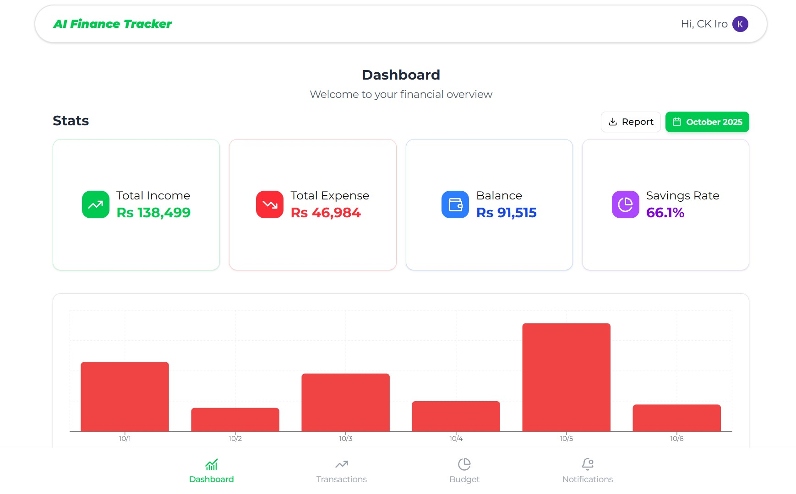

# AI Financial Tracker - (Clerk | Amazon S3 | Netlify | Render) 

 

> A smart, AI-powered MERN stack finance tracker designed to simplify income and expense management. Where users can make transactions & make budgets for different types of categories. This is the **Frontend** repository, built on React with responsive design for a seamless user experience.

## 🎯 The Problem This Solves

### Challenge: Manual Money Tracking is a Chore

Many people struggle with finance tracking because it's **time-consuming** and **error-prone**. Manually entering every transaction, especially from paper receipts, often leads to missed entries, delayed budgeting decisions, and ultimately, an inaccurate view of personal finances. This friction makes users abandon tracking, leading to poor spending habits.

### Our Solution: AI-Powered Automation & Proactive Alerts

-  **Eliminating manual entry fatigue** → 
    - Users simply snap a picture of a receipt, and our AI model extracts the data, auto-generating a draft transaction.
    - Entirely handled by the backend API so users no longer need to enter records manually.
-  **Super easy budgeting** → 
    - Users can make budgets to keep track of all their spendings.
    - Also shows stats so users are fully aware of their financial status.
-  **Enforcing discipline** → 
    - The proactive notification system (inactivity reminders, budget threshold alerts) keeps users engaged and informed.
    - Makes sure they stay on top of their spendings before it's too late.

## ✨ Features

This highlights the main functionalities the user interacts with through this frontend interface.

  * **AI-Powered Transaction** → Submit receipt images and review the draft transactions automatically created by the OCR service.
  * **Comprehensive Transaction Management** → Seamlessly **add, view, edit, and delete** income and expense transactions.
  * **Proactive Budgeting System** → Create and monitor **expense budgets** with clear visual tracking against spending limits.
  * **Intelligent Alerts & Notifications** → View all automated alerts for budget thresholds and inactivity reminders on a dedicated page.
  * **Intuitive Dashboard** → Get a quick financial overview with **total income, expenses, remaining balance, and savings percentage** displayed with a detailed  bar chart.
  * **Dynamic UI** → The Transactions page features a **switchable view** (table/cards) for improved data readability.

## 🖼️ User Interface & Workflow

  * **Homepage (Landing Page)** → Introductory page for visitors to learn about the app. (Dummy data used, Will be updated with real info soon)
  * **User Dashboard** → The main hub after login. Displays a monthly/yearly financial summary, a **Shadcn UI bar chart** of all transactions, and a list of recent activities.
  * **Transactions Page** → Central area for manual transaction entry, AI receipt submission, category management, and detailed viewing of all transactions and **Amazon S3** stored receipt images.
  * **Budgets Page** → Shows budget statistics, progress bars, and budget cards. Allows users to **add new budgets**.
  * **Notifications Page** → Displays all **auto-generated alerts** fetched from the backend.

## 🛠️ Tech Stack (Frontend)

This section details the technologies used specifically in this repository.

  * **Framework** → Vite + ReactJS (JSX)
  * **Styling** → Tailwind CSS with Shadcn UI Components
  * **State Management** → Zustand (Global State) & Tanstack React Query (Data Fetching/Caching)
  * **Routing** → React Router DOM
  * **Forms & Validation** → React Hook Form with Zod
  * **Charting** → Recharts
  * **Authentication** → Clerk's built-in components for user authentication
  * **Deployment** → Netlify 🔗 [Client App](https://ai-financial-tracker.netlify.app) 

## 🔗 Backend API

This frontend application communicates with a separate API built with Node.js and MongoDB. You can find the backend repo from below.

**Backend Repository** → 🔗 [ckiroshan/AI-Financial-Tracker-Backend](https://github.com/ckiroshan/AI-Financial-Tracker-Backend)

## ⚙ System Architecture

This frontend application, a **Client App** built with ReactJS, serves as the user's direct interface, handling requests and responses. It interacts with a **NodeJS Server (Backend)** which manages data persistence in **MongoDB** and integrates with external services like **Amazon S3** for receipt storage and the **Gemini API** for OCR capabilities.

### Key Data Flow Interactions:
-  **User Request** → 
    - **User** sends requests to **Frontend** to process. 
    - Then utilize Clerk for authentication and Tanstack React Query for efficient data management.
-  **Backend Communication** →  
    - **Client App** communicates with **NodeJS Server (Backend)** to fetch or post data.
-  **Receipt Image Submission** →  
    - When user submits a receipt image from frontend, it's sent to **Backend** & performs 3 operations
      * **Storage** →  posts image to an **Amazon S3 bucket** for secure storage.
      * **OCR Processing** →  sends image to **Gemini API** to parse image & extract textual data.
      * **Draft Transaction Creation** →  After OCR, **Backend** processes extracted text into a draft transaction.
-  **Data Persistence** →  
    - The **Backend** interacts with **MongoDB** for all data operations. 
    - Including storing user information, transactions, categories, and budgets.
-  **Response to User** →  
    - Finally, the **Backend** sends processed data back to **Frontend**, 
    - which then renders the appropriate **Response** for the **User**.

## ⚠️ Known Bugs (Work in Progress)
  * In transaction edit modal. if type changes, category shrinks without text. needs to show select category instead.
  * On form (close, cancel, click away), form doesn't reset. Page refresh works.
  * Sometimes title or note is long in transactions and causes icon to look small. must set a max length for text.

## ⚡ Planning → Execution
  * This is a group project handled by a team of 5 (Lead by me). 
  * All project objectives were well defined right from start.
  * Hence, the whole project was divided into 3 phases & was executed accordingly.
    * 🔗 [**Phase 01**](https://docs.google.com/document/d/14EJ5JAH_8Oh615vejmpy_xJDgybgjOuiD_j3d3Z-_jo/edit?usp=sharing) - [**Task Breakdown structure 01**](https://docs.google.com/document/d/1I3zDMTb0k1E-CiFljy334bu7mNO4CP9broNUNVw7hMg/edit?usp=drive_link)
    * 🔗 [**Phase 02**](https://docs.google.com/document/d/1js6duJJN5CfCvkjBX4C0IqcPxZyHsUPGmy9c3jZA_jc/edit?usp=sharing) - [**Task Breakdown structure 02**](https://docs.google.com/document/d/14T840J4V1hhSJJfBkzBY5e4WVnVY3VfFn9p_Q11Vrr0/edit?usp=sharing)
    * 🔗 [**Phase 03**](https://docs.google.com/document/d/1RNheSI7fS1XBJ6mjRmpC542By9AQdRkmqilNimbFSEQ/edit?usp=sharing) - No Breakdowns, just connecting frontend to backend
    * 🔗 [**A.I Usage Document**](https://docs.google.com/document/d/15k-y1bDu6c72uONTr0rdLbDSX5C5ZWDqGrIT61MwAB4/edit?usp=sharing) - How the A.I part was planned & executed
  * We saw each other's strengths, weaknesses & helped each other work efficiently in a collaborative environment.
  * Each feature branch was developed & pushed to create PRs & merged to main upon review.
  * We managed to hit all our MVP features on time & later spent time improving the UI.

## 💡 Future Improvements
This section outlines potential future enhancements for this project in future
  * **Report Generation** →  
    - Generate a report of current financial stats for the given date range.
  * **AI Voice** →  
    - Incorporate AI Voice to Transaction (similar to receipt generation).
  * **Advanced Data Visualization** →  
    - Incorporate additional chart types (e.g., pie charts for category breakdown) 
    - Time-series comparisons on the Dashboard.
  * **Improved Accessibility** →  
    - Enhance keyboard navigation and screen reader support across all site components.

## 👨‍💻 Contribution
This project was successfully pulled off by a team of passionate developers from start till end & we had so much fun building it. Currently We don't accept external contributions or pull requests. Thank you.
